# Processing test results

Run on 4 November 2026 against the C11 executable. Image fixtures and rendered comparisons are stored beside this page; no test suite or fixture generator was added to the source tree. [Open the image gallery](../../_docs/assets/development/tests/gallery.html) for side-by-side previews.

## Results

| Case                                                               | Outcome                                                                   |                        Size |
| ------------------------------------------------------------------ | ------------------------------------------------------------------------- | --------------------------: |
| PNG lossless copy (`samples/bald.png`)                             | Byte-identical; CRC-32 and SHA-256 match.                                 | 1,560,548 → 1,560,548 bytes |
| PNG vector (`samples/bald.png`, 2 colours)                         | Valid SVG; portrait remains recognizable.                                 |    1,560,548 → 37,511 bytes |
| PNG vector (`samples/duck.png`, 16 colours, 0.5 px)                | Valid SVG; intentionally lossy and larger than source.                    | 3,022,718 → 3,607,243 bytes |
| JPEG vector (`docs/development/tests/before/test.jpeg`, 2 colours) | Valid SVG; sketch detail retained.                                        |     393,983 → 130,278 bytes |
| PDF image stream (`samples/image-stream.pdf`, Flate DeviceGray)    | One image object vectorized; the one-page 100 × 100 pt PDF remains valid. |             905 → 787 bytes |
| TCMP archive round trip (`samples/repeated.txt`)                   | Restored bytes match source.                                              |       397 → 419 → 397 bytes |

Vector output is a derived Terra sketch, not general-purpose image compression. The two-colour mode discards colour and detail; the 16-colour duck export demonstrates that SVG can be larger than its source.

## PNG decode coverage

All 19 PNG inputs decoded to RGBA bytes matching an independent reference pixel array exactly, then produced valid SVG output. Coverage includes grayscale 1/2/4/8/16-bit, RGB 8/16-bit with transparency keys, indexed 1/2/4/8-bit with palette alpha, grayscale-alpha and RGBA 8/16-bit, and Adam7 interlacing across colour types. Every output passed `xmllint --noout`.

The following pairs are scaled previews; original-depth fixtures and generated SVGs are retained in `before/png-cases/` and `after/png-cases/`.

| PNG case           | Before                                                                | After                                                               |
| ------------------ | --------------------------------------------------------------------- | ------------------------------------------------------------------- |
| `gray-1`           |                      |                      |
| `gray-16`          | 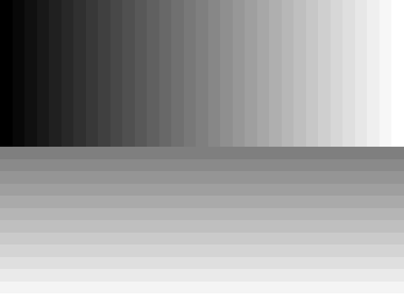                   | 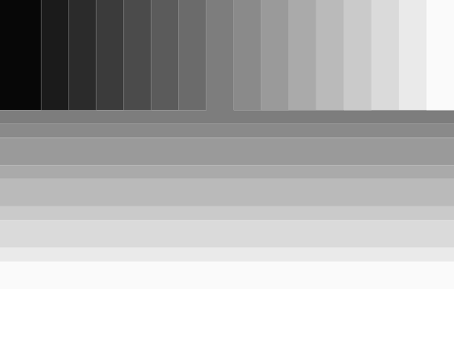                   |
| `gray-2`           |                      |                      |
| `gray-4`           | 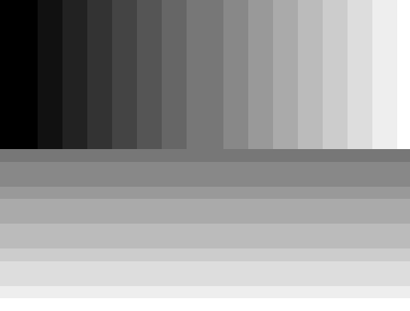                     | 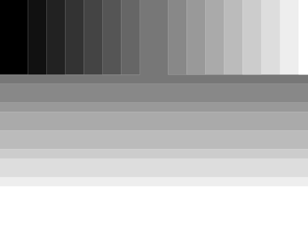                     |
| `gray-8-trns`      | 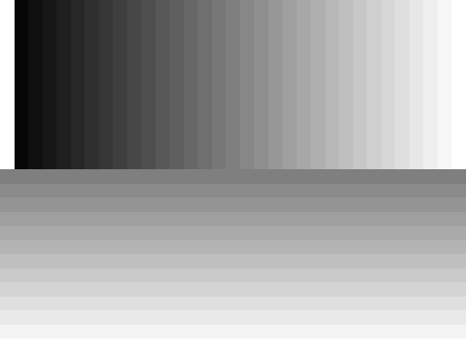           | 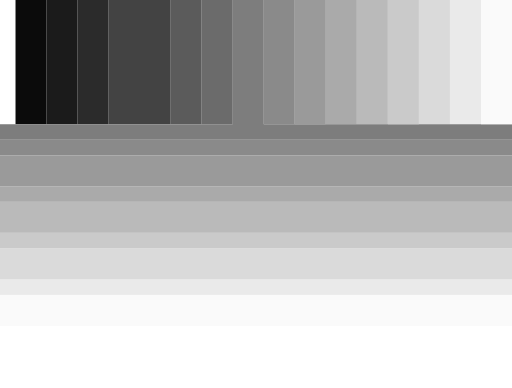           |
| `gray-8`           | 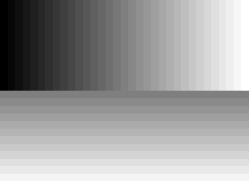                     |                      |
| `gray-alpha-16`    | 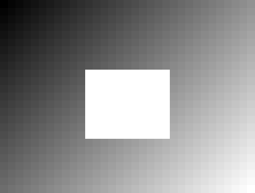       | 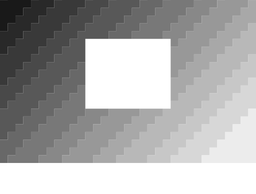       |
| `gray-alpha-8`     |          |          |
| `gray-alpha-adam7` | 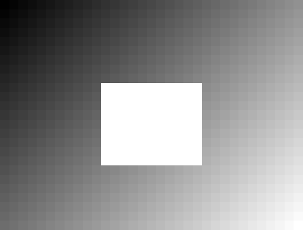 |  |
| `palette-1-alpha`  | 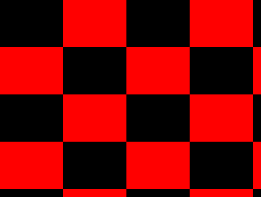   | 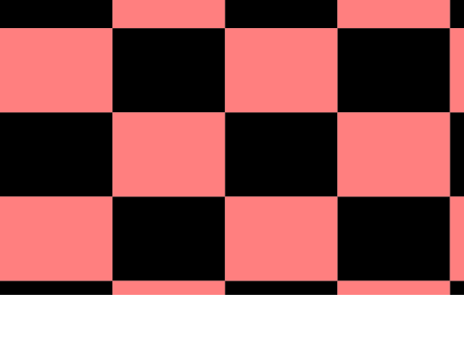   |
| `palette-2-alpha`  |    | 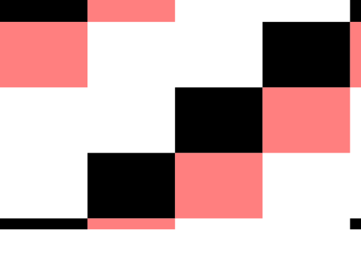   |
| `palette-4-alpha`  | 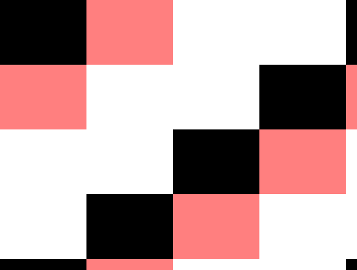   |    |
| `palette-8-alpha`  |    |    |
| `palette-adam7`    | 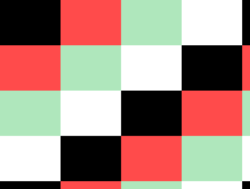       | 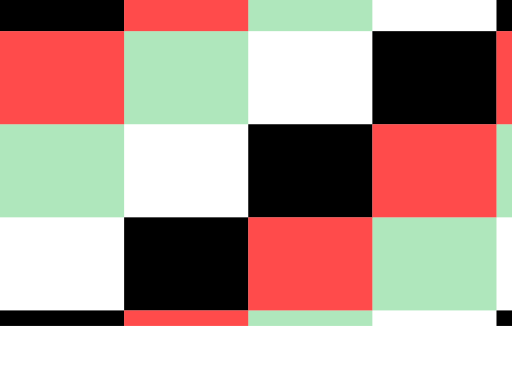       |
| `rgb-16`           | 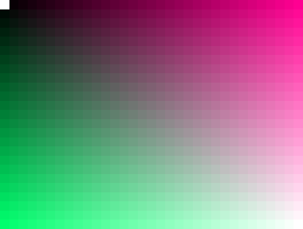                     |                      |
| `rgb-8`            | 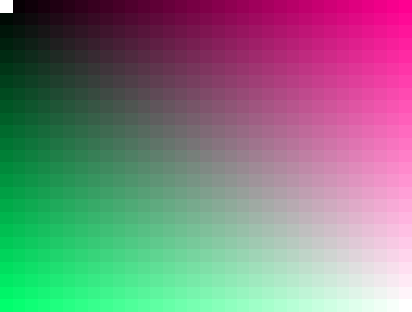                       | 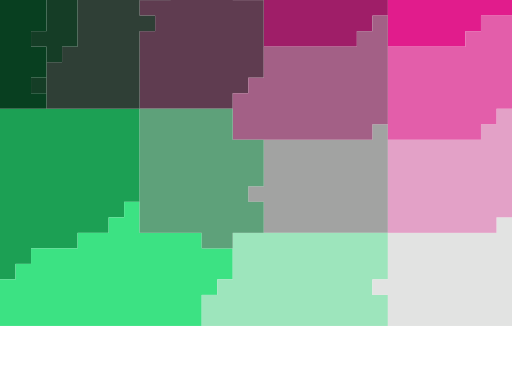                       |
| `rgba-16`          | 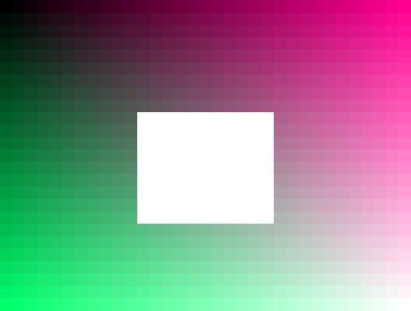                   |                    |
| `rgba-8`           |                      |                      |
| `rgba-adam7`       |              | 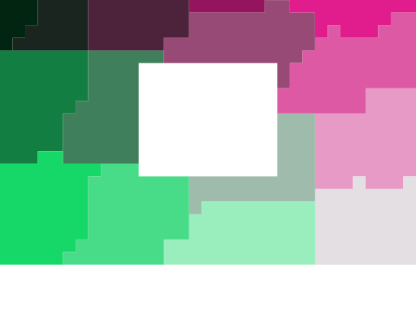             |

PNG source and outputs:

| Before                                         | After                                                       |
| ---------------------------------------------- | ----------------------------------------------------------- |
|  |              |
| 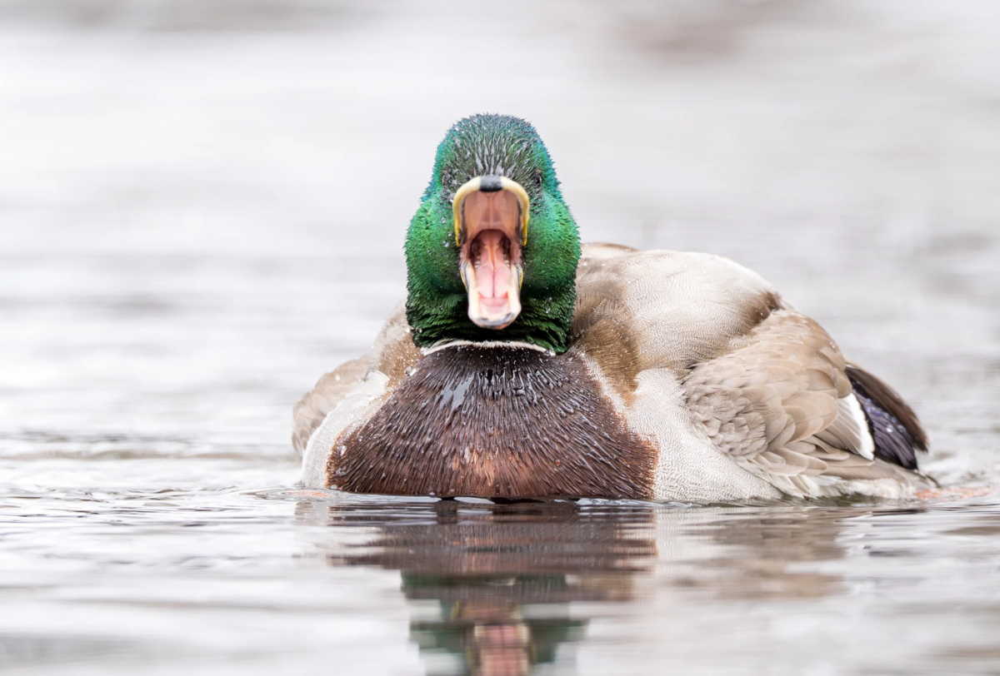 | 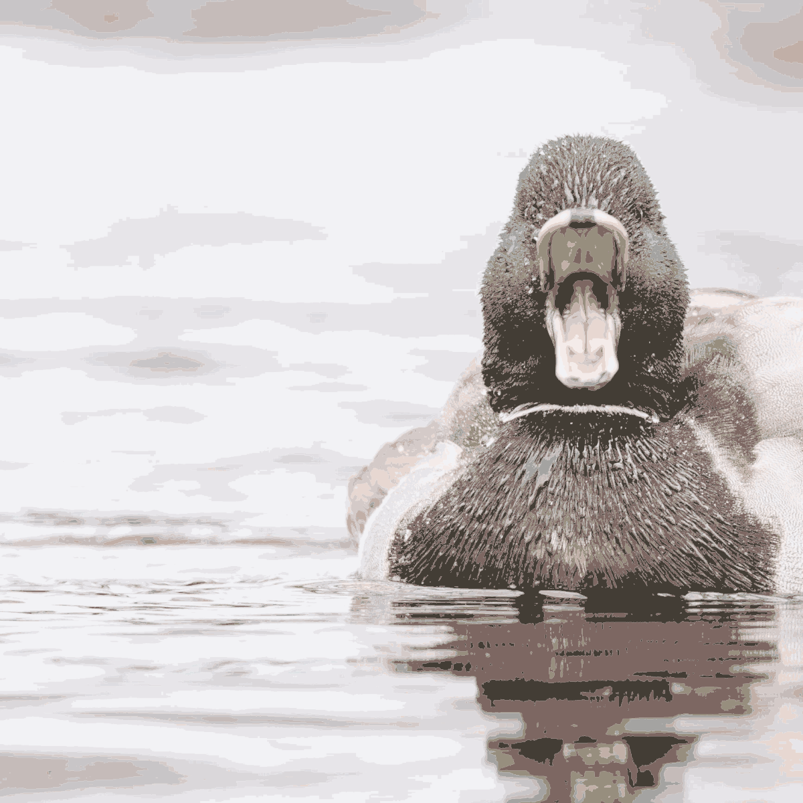 |

JPEG source and vector result:

| Before                                            | After                                              |
| ------------------------------------------------- | -------------------------------------------------- |
| 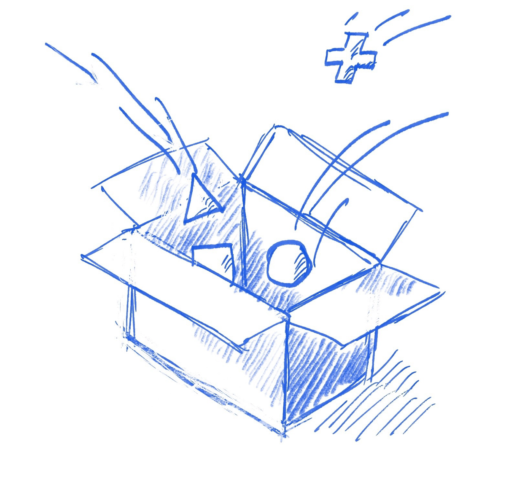 | 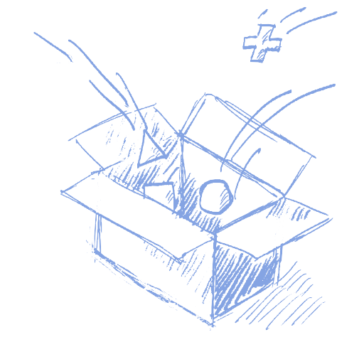 |

PDF processing covers two distinct outcomes:

| Fixture | Result | Before / after |
| --- | --- | --- |
| `image-stream.pdf` | One Flate grayscale image; 905 → 787 bytes; one 100 × 100 pt page. |  →  |
| `rebuild.pdf` | Shared Flate RGB XObject rebuilt in a two-page PDF; one image processed, zero unsupported; 50,350 → 1,571 bytes. Page text and 300 × 220 pt geometry retained. | 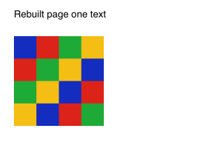 → 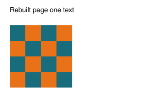<br /> →  |
| `multi-image.pdf` | Two pages, text, shared Flate RGB, JPEG DCT, and Flate soft mask. Three images processed, zero unsupported. The 396,361-byte source was retained unchanged because the 1,650,678-byte vector candidate was larger. |  → 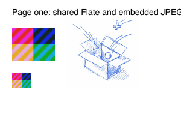<br /> → 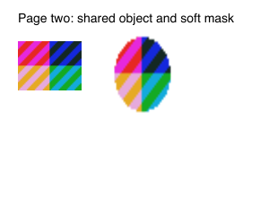 |

`pdfinfo` verified page count, dimensions, and file sizes. PDFKit extracted `Rebuilt page one text` and `Rebuilt page two text` identically before and after rebuilding. The no-size-reduction PDF is byte-identical before and after (SHA-256 `2bd986816b99007a4484ca5483216da090e99fefcb0828f42ece46972501b0d1`).

## Commands and safeguards checked

- `make clean && make`, `./compression-demo --help`, and `pnpm run build` passed. CLI verification included account creation/sign-in, media processing, archive round-trip, invalid and truncated input rejection, destination collision protection, explicit replacement, unwritable output paths, and the interactive blank-output sibling name. The Docs dev command reaches Astro ready on port 3010 but the shared app fails during server startup (`module is not defined` in the aliased React CommonJS entry). A temporary node_modules-only workaround did not resolve the runtime and was restored. The built static Docs site is served on port 3014.
- Interactive PNG mode selection and a blank destination created the expected `-compressed.svg` sibling. PNG lossless copy compared byte-for-byte with the source.
- Missing input was rejected before the output-path prompt. Existing destinations remained unchanged without `--force`; explicit replacement succeeded.
- Invalid PNG/PDF signatures and a truncated JPEG were rejected without outputs. A corrupted TCMP archive was rejected without a restored file. All 19 PNG SVGs passed `xmllint --noout`; rebuilt PDFs passed `pdfinfo` and rendered with `pdftoppm` at matching page dimensions.
- Corrected `config/quality.json` so the quality runner resolves the repository root rather than `config/`. Build, C formatting, source analysis, and docs checks pass. With Homebrew LLVM on `PATH`, `clang-tidy` runs but reports 1,989 diagnostics, including missing direct includes, unchecked I/O, magic constants, and complexity/style findings.

## Reproduce

`make run` opens the menu. On first launch create a local account, then sign in; subsequent CLI commands also prompt for sign-in. In a fresh checkout, the CLI archive round trip is:

```sh
make
./compression-demo compress samples/repeated.txt /tmp/repeated.tcmp
./compression-demo decompress /tmp/repeated.tcmp /tmp/repeated.restored
cmp samples/repeated.txt /tmp/repeated.restored
```

Process media with the CLI after signing in:

```sh
./compression-demo process samples/bald.png /tmp/bald.svg --mode vector
./compression-demo process samples/duck.png /tmp/duck.svg --mode vector --colors 16 --tolerance 0.5
./compression-demo process docs/development/tests/before/test.jpeg /tmp/test.svg --mode vector --colors 2
mkdir -p /tmp/image-stream-svg
./compression-demo process samples/image-stream.pdf /tmp/image-stream-out.pdf --mode vector --svg-dir /tmp/image-stream-svg --force
```

The `--svg-dir` parent must already exist. `--force` explicitly allows replacing outputs.

All before/after render files and the PDF fixtures are retained in this folder. PNG fixture generators, pixel-check harnesses, and temporary scripts stayed under `/tmp`; no test suite was added.
